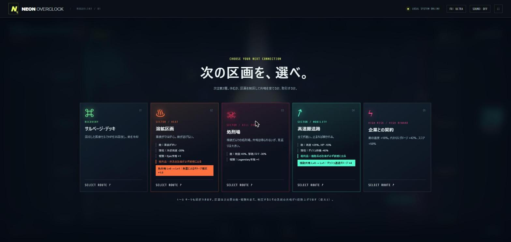
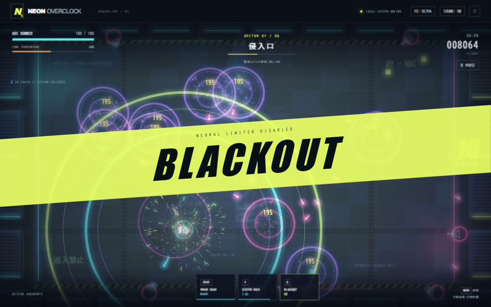

# NEON OVERCLOCK

雨の企業タワーを登り、管理AI CERBERUSから自分の所有権を奪還する、サイバーパンク・アクションローグライク。

2097年。復興事業で電力・物流・義体医療を握った3社が街を奪い合う。元現場班の3人は、企業タワーから義体の制御権を取り戻し、街の不足を埋める回収屋として仕事を始める。

## 遊ぶ

GitHub Pagesで公開した場合は、公開URLをスマホやPCのブラウザで開いて遊べます。PCでは `index.html` をブラウザで開くか、Windowsで `PLAY.cmd` をダブルクリックするとオフラインでも遊べます。

タイトルの **ゲームを共有** から公開リンクをコピーできます。リザルトの **戦績を共有** には、ボディ・攻略結果・タイム・撃破数を含められます。**Xで共有** を押すと、本文と公開リンクを入れたXの投稿画面が開きます。対応端末では共有メニューも使えます。

ローカルサーバーを使う場合は、Node.jsで `npm start` を実行し、表示された `http://127.0.0.1:47831` を開きます。

| 操作 | PC | スマホ |
| --- | --- | --- |
| 移動 | WASD / 矢印 | 左下のスティック |
| 無敵ダッシュ | SPACE | DASH |
| 範囲ハック・敵の行動停止 | E | HACK |
| BLACKOUT / 充填後に全体攻撃 | Q | BLACKOUT |
| 一時停止 | ESC | PAUSE |
| 現在のボディ・改造を確認 | I / BODY | BODY |
| 宝箱・改造の選択 | マウス / 1・2・3 | カードをタップ |
| ルート選択 | マウス / 1〜5 | カードをタップ |
| 宝箱の獲得画面から戻る | ENTER / SPACE / ボタン | 戦場へ戻るボタン |

攻撃・照準は自動です。赤い照準線や円形の予告を避けながら、敵を倒してエネルギーを貯めてください。緑のセルは回復、シアンは冷却、黄色はエネルギーです。ダッシュの通過経路にあるセルと宝箱も回収できます。

PCではキーボード用の表示、スマホなどタッチが主入力の端末では専用の操作UIが出ます。縦持ち・横持ちのどちらでも、移動しながら右手で技を使えます。右下のボタンに再使用までの時間とBLACKOUTの充填率が出ます。タブ移動やウィンドウのフォーカス喪失時は自動で一時停止します。

画面上部の `SOUND` で音楽・効果音を有効にできます。音はすべてWeb Audioで合成しています。`FX` で発光・粒子の量を切り替えられます。タッチが主入力の端末では、初期設定で `FX: LITE` を使います。

## GitHub Pagesで公開する

1. GitHubリポジトリのデフォルトブランチにこのプロジェクトをpushします。
2. リポジトリの **Settings → Pages** で **Source** に **GitHub Actions** を選びます。
3. **Actions → Deploy NEON OVERCLOCK to GitHub Pages → Run workflow** でデフォルトブランチを選びます。配信完了後、デプロイ結果に公開URLが表示されます。次回以降はデフォルトブランチへのpushで自動更新されます。

### GA4で閲覧数とプレイ開始数を測る

1. [Google アナリティクス](https://analytics.google.com/)でプロパティを作成し、**データ ストリーム → ウェブ** から `https://zenpou.github.io/neon-overclock/` のストリームを追加します。
2. 表示された測定ID（`G-` で始まる文字列）をコピーします。
3. GitHubリポジトリの **Settings → Secrets and variables → Actions → Variables** で、名前 `GA4_MEASUREMENT_ID` の **Repository variable** を作り、測定IDを保存します。
4. Pagesワークフローを再実行します。`index.html` と `help.html` の閲覧はGA4標準の `page_view`、タイトル画面から実際に侵入を始めたときは `game_start` イベントとして記録されます。

GA4の **レポート → リアルタイム** で受信を確認できます。プレイ開始人数は、**レポート → エンゲージメント → イベント** で `game_start` を選び、ユーザー数を確認します。測定IDが未設定のローカル実行では計測リクエストは送信されません。

ワークフローは構文チェックとテストを実行し、ゲーム本体と画像を配信します。公開URLは通常 `https://<ユーザー名>.github.io/<リポジトリ名>/` です。[GitHub Pagesの公開ソースを設定する](https://docs.github.com/ja/pages/getting-started-with-github-pages/configuring-a-publishing-source-for-your-github-pages-site)

## ビルド

- **ARC RUNNER**：高速移動と連鎖する雷撃。
- **HEAT SAMURAI**：広範囲の灼熱斬撃。
- **GHOST ENGINEER**：追従ドローンによる支援射撃。

全8層。道中で敵を倒すと、光の柱が立つSF宝箱 **DATA VAULT** が出現します。接触かダッシュで開封し、ランダムな3候補から1つずつ選んで装着します。Rareは1回、Epicは3回、Legendaryは5回選択でき、候補は毎回引き直します。同じ回の候補は重複しませんが、所持済みの改造も候補に出るので重ねて強化できます。選択中は戦闘が止まり、すべて選び終えたら獲得一覧から戦場へ戻ります。フロア制圧時には残った宝箱も回収するため、拾い忘れで報酬を失いません。第1〜7層の制圧後には、さらに3択の改造部品から1つを選び、次のルートを選択します。改造は重複し、ダメージ倍率の乗算、連鎖の増加、ドローンの増設などでビルドが急成長します。弾数や機数などは描画負荷を抑える上限を設けています。敵の一撃も重くなり、回復に頼って被弾を続ける戦い方は危険です。ルートは休息・区画・取引の3種類から選びます（下の「ルートと共鳴」）。同じ改造は5個まで、全体ダメージ倍率の2種（ヴォイド・レンズ、マグマ・コア）は3個までです。第8層は多段階のボス戦です。CERBERUS は適応装甲を持ち、一定以上の火力は減衰されます。ルート戦略9種×3ボディ×6シードの自動操作162通りは全勝で、撃破までの戦略別平均は15〜31秒。火力が高いほど早く倒せますが約14秒より短くはなりません（調整値は `engine.js` の `BOSS_TUNING`）。

攻撃で熱が増え、高温時にはダメージが増加します。上限に達すると冷却するまで攻撃停止。ダッシュとハックで時間を稼いでください。

死亡後はそのランの改造を失い、再挑戦できます。序章のベストスコアとクリア回数、音声・画質設定はブラウザ内に保存します。

## 回収屋のアジト

CERBERUSを倒すと、クリア結果またはタイトルから **依頼掲示板** に入れます。以前のクリア記録があるブラウザでも解放されます。

1. 電力・物流・義体医療から企業を選び、施設と侵入口、危険ランク、報酬、追加警備を確認します。
2. 出撃担当を一人選び、所持している攻撃装備・防御装備を持たせます。現場のDATA VAULTと制圧報酬では、その出撃の改造を積めます。
3. 依頼の最終防衛機を破壊すると納品でき、報酬がチームの財布に入ります。撤退・敗北した依頼は無報酬です。再読み込みで中断した戦闘は、次の出撃時に破棄されます。
4. **チームと装備** で共用装備の購入や強化、キャラ単位の恒久改造、追加メンバーの契約ができます。

最高ランクの依頼を攻略すると、全社で次のランクに挑めます。企業別の最高記録は掲示板に出ます。ランクを指定して以前の難度にも戻れます。ランク3で広域施設、ランク5で中央施設が加わります。依頼戦は3〜4層です。同じ入口に成功が重なると追加警備が入り、別のルートの攻略で警戒が下がります。報酬は正式な危険ランクで決まり、ランク1の1,200から1段ごとに約1.5倍になります。

攻撃装備は威力、防御装備は被ダメージ、人体改造は選んだキャラの両方に効きます。装備と改造の段階が両方1上がると、敵の危険ランクが1上がる分に相当します。チーム資金、加入状況、持ち込み装備、人体改造、企業ごとの攻略記録はブラウザに保存されます。

各社の敵は装甲と攻撃の相性が違います。戦闘中に照準先の敵の弱点が出て、中ボスと最終防衛機の弱点はそれぞれのHPバーに表示されます。依頼の最後から2番目の区画では途中で中ボスが現れ、撃破するとEpic以上のDATA VAULTを確実に落とします。弱点ヒットの与ダメージは通常敵と最終防衛機で1.5倍、中ボスで1.65倍、耐性のある攻撃では0.8倍です。

| 企業 | 中ボスの攻撃 | 中ボスの弱点 |
| --- | --- | --- |
| 電力 | 変電重装機の放射弾 | ハック・雷撃・感染 |
| 物流 | 貨物破砕車の直線突進 | 斬撃・ダッシュ・ワイヤー |
| 義体医療 | 義体保全機の円形衝撃波 | 炎上・熱波・BLACKOUT |

設計と検証項目は [企業襲撃キャンペーン実装プラン](CAMPAIGN_PLAN.md) にまとめています。

## ルートと共鳴

第1〜6層を制圧すると、次の層へのルートを5つの候補から選びます。

| 枠 | 内容 |
| --- | --- |
| 休息（1枠） | 代償なしの回復。必ず1つ出ます。 |
| 区画（3枠） | 次の層の敵構成・環境・報酬を書き換えます。1枠目は現在いちばん育っている系統の区画、残り2枠は別の区画。直前に制圧した区画は出ません。 |
| 取引（1枠） | 闇医者・企業契約・闇市・指名手配。恒久的な代償と引き換えの強化。 |

区画は7種類あります。

| 区画 | 次の層 | 伸びる系統 |
| --- | --- | --- |
| 送電区画 | 射撃型が主体、敵HP -15%、同時出現 +3 | 雷撃 |
| 溶鉱区画 | 重装が多い、冷却速度 -35%、Epic宝箱 +1 | 熱 |
| ドローン格納庫 | 突撃型の群れ、敵HP -30%、撃破ノルマ +30% | ドローン |
| 隔離病棟 | 敵HP +40%・速度 -15%、ハック待機 半減 | 感染 |
| 装甲保管庫 | 精鋭が混ざる、敵の攻撃力 +15%、制圧で最大HP +30 | 装甲 |
| 高速搬送路 | 敵速度 +25%・HP -10%、ダッシュ待機 -40% | 機動 |
| 処刑場 | 精鋭 40%、撃破ノルマ -30%、Legendary宝箱 +1 | なし |

**脅威度**：区画を1つ制圧するたびに脅威度が1上がり、以後の敵のHPが +12%、攻撃力が +18% ずつ上がります（ボスの攻撃力にも掛かります）。区画で共鳴と戦利品を取るほど塔は危険になり、休息と取引では上がりません。取引「指名手配」は脅威度を一気に +5 する代わりにスコア倍率を +2 します。出るたびに何度でも重ねられるので、腕に自信があるほど自分で難度を上げられます。第1層だけは敵の攻撃力が55%に抑えられています。現在の脅威度は層表示とルート選択画面に出ます。

系統つきの区画では、宝箱と制圧報酬の候補にその系統の改造が毎回1枚入ります（カードに SECTOR FOCUS と表示。その系統の改造がすべて上限に達した後は入りません）。制圧すると、その系統の**共鳴**が1段階上がります（最大Lv3）。

| 共鳴 | Lv1 | Lv2 | Lv3 |
| --- | --- | --- | --- |
| 雷撃 | 連鎖 +2、連鎖係数 +1.0 | 倒した敵から連鎖放電 | 連鎖の距離 ×1.6、威力 ×2 |
| 熱 | 射撃・斬撃が敵を3秒間炎上させる | 炎上中の敵は倒れると爆発して燃え移る、オーバーヒートが熱波になる | 射撃・斬撃の間隔 ×0.7、炎上ダメージ ×2 |
| ドローン | ドローン +1、威力 ×1.3 | ドローン弾が着弾時に爆発 | 射撃間隔 ×0.7 |
| 感染 | 感染を解放、全攻撃が感染を付与、感染ダメージ ×3 | 感染した敵は倒れると爆発 | 感染中の敵への全ダメージ +40% |
| 装甲 | 被ダメージ -30%、半径130の帯電装甲が近づく敵を焼く（最大HP比例） | フェイズ・シールドが戦闘中に1回分回復する間隔を12秒から6秒に短縮。回復上限は取得数×2回分 | 毎秒、最大HPの2%を回復 |
| 機動 | ダッシュ通過ダメージ ×4 | ダッシュ撃破で待機リセット、2秒間ダメージ +35% | ダッシュ距離 +70、通過ダメージ ×2 |

各系統の入口になる改造（ドローン工場、ウイルス・シード、アーク・リンク、ブレード・マトリクス）は、その系統を最初から持つボディか、対応する区画の中でだけ候補に出ます。区画を制圧して共鳴Lv1を得るか、その系統を一度持てば、以後は通常の層でも出ます。つまりどの区画を通ったかで、そのランで使える系統が決まります。

第7層の後（ボス前）は区画が出ず、休息・取引・ボス用の準備（武器庫：シールド +2とBLACKOUT充填、弱点解析：最大HP -20で適応装甲が通す火力 +50%）から3つが並びます。

現在の区画はHUD右上の層表示に、共鳴は左下の改造アイコンの下に表示されます。結果画面には育てた共鳴とダメージ源の内訳が出ます。



## 映像表現

統一したサイバーパンク・アニメ調の透過画像を使用。3人の全身立ち絵、主人公の4方向×3人、敵・ボス・ドローン、6系統の改造装備を収録しています。雷撃・熱・ドローン・感染・装甲・機動の改造を取得すると戦闘中の主人公に対応する装備が付き、同系統を重ねるとTier II／IIIへ成長します。混成ビルドでは複数系統の装備を同時に表示します。

タイトルの **BODY LAB** で3人と全6系統を自由に試着できます。試着は能力値に影響しません。戦闘中の **I / BODY** は一時停止して所持改造と現在の外見を確認する機能です。素材と生成仕様は [assets/ART_DIRECTION.md](assets/ART_DIRECTION.md) にまとめています。

手続き生成した屋上、濡れた床、雨、サーチライト、発光する装甲、弾道、稲妻、ダッシュ残像、斬撃、衝撃波、破片、ダメージ表示、連鎖数カウンター、BLACKOUTカットインをCanvas 2Dで描画します。粒子数・解像度に上限を設け、背景と発光素材はキャッシュしています。OSの「動きを減らす」設定では画面揺れ・全画面フラッシュを抑えます。

v1.3 で演出を強化しました。撃破時の破片・焦げ跡・閃光、分岐する稲妻、レア度で変わる宝箱の光柱と放射光、BLACKOUT の暗転と落雷、ボス登場・第2形態・多段爆発の撃破演出、制圧時の花火を追加。重い被弾や大型敵の撃破には短いヒットストップ、BLACKOUT とボス撃破にはスローモーションが入ります。宝箱・制圧・死亡・クリアの各画面は、戦場の演出を見せてから開きます（0.5〜3秒）。連鎖数に応じた足元のオーラ、HP低下時の赤い縁取り、連鎖カウンターの脈動も追加しました。「動きを減らす」設定ではヒットストップ・ズーム・画面揺れ・フラッシュを無効にします。



## 開発と検証

```text
npm run check
npm test
npm start
```

- `engine.js`：ブラウザに依存しない戦闘・進行ロジック。
- `renderer.js`：背景、キャラクター、演出。
- `app.js`：入力、UI、音楽、保存。
- `engine.test.cjs`：戦闘・進行・再挑戦の回帰テスト。

- `artifacts/fx-fixture.html`：レンダラーへ任意のイベントを流して演出を確認する検証ページ（`fx.fire({type:'ultimate',x:800,y:500})`、`fx.step(10)`）。
- `artifacts/route-sim.cjs`：ルート戦略ごとの自動走行を回し、勝率・改造の系統別枚数・共鳴・ダメージ源の内訳を集計します（`node artifacts/route-sim.cjs . 11,23,37`）。第4引数に戦略名、第5引数に操作の腕前（`expert` / `average` / `novice`）を指定できます。
- `artifacts/realtime.cjs`：一時プロファイルのヘッドレスChromeを起動し、実時間で自動プレイしてフレーム時間を記録します（`node artifacts/realtime.cjs . 260 ultra artifacts/realtime-play.jpg`）。セーブは書き換えません。
- `artifacts/app-fixture.html`：本体をそのまま読み込み、`stepFrames(n)` でゲームループを手動送りする検証ページ。背面タブでも進行を再現できます。

描画性能は `index.html?perf` で開くか、プレイ中に **F2** を押すと画面下に表示されます（戦闘中の直近600フレームの平均FPS、95パーセンタイルのフレーム時間、20msを超えたフレームの割合、最悪値、粒子数の最大）。20ms超が数%を超えるようなら `FX: LITE` を使ってください。

実機のタッチ操作は未検証です。実時間の計測（RTX 3070・1584×805・75Hz、ULTRA、クリアまで140秒の自動プレイ）では、平均73.6〜75.1fps、95パーセンタイル13.5ms、20msを超えたフレームは最大で2%（第7層）でした。別のGPUでは未計測です。ブラウザとGPUにより描画性能は変わります。

最新の戦闘・宝箱の検証は [artifacts/loot-validation.md](artifacts/loot-validation.md)、以前の画像・基本操作の検証は [artifacts/validation.md](artifacts/validation.md) を参照してください。
